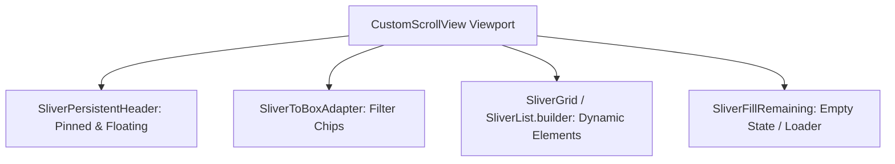

# Flutter Animations, Slivers & Motion Master

This skill provides advanced patterns for high-performance visual motion in Flutter, including Slivers architecture, physics-based springs, CustomCanvas drawing, and vector animation runtimes.

---

## 🎨 Slivers Hierarchy & Scroll Coordinates

---

## 🎯 Production Invariants

1. **Never Nest Unconstrained Scrollables**: Avoid `ListView` with `shrinkWrap: true` inside a `SingleChildScrollView`. Replace with `CustomScrollView` and sliver children to keep element recycling active.
2. **Hardware Acceleration via RepaintBoundary**: Always isolate animated widgets or `CustomPainter` widgets inside a `RepaintBoundary` to prevent raster repainting of static ancestors.
3. **Dispose Controllers**: All `AnimationController` instances must be disposed in `State.dispose()`, and listeners detached.
4. **Prefer TweenAnimationBuilder / flutter_animate**: For simple micro-interactions, avoid verbose boilerplate controllers; use implicit widgets or `flutter_animate` chains.

---

## 📋 Prosedur Eksekusi

1. **Panduan Slivers & Custom Header**:
   - Rujuk panduan di [references/slivers-guide.md](./references/slivers-guide.md).
2. **Template Custom SliverPersistentHeader**:
   - Rujuk kode di [resources/sliver-header.dart](./resources/sliver-header.dart).
3. **Audit Render Performance**:
   - Jalankan `bash scripts/check-animation-leaks.sh`.
