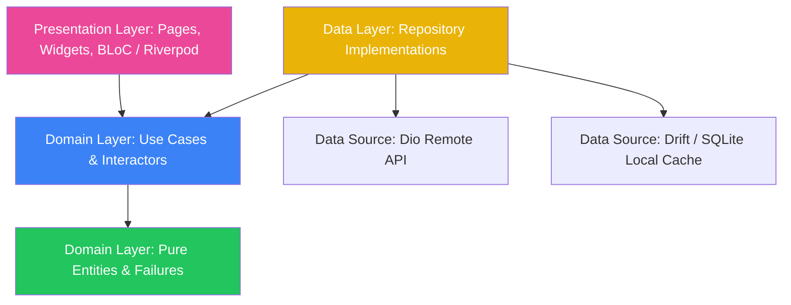

# Flutter Clean Architecture & TDD Master

This skill enforces strict Clean Architecture and Test-Driven Development (TDD) for Flutter applications, isolating core domain logic from UI frameworks, database engines, and third-party APIs.

---

## 🏛️ Clean Architecture Layer Dependency Rule

*The Dependency Rule: Dependencies point ONLY inwards toward the Domain.*

---

## 🎯 Production Invariants

1. **Domain Isolation**: The `domain/` directory must NEVER import Flutter UI packages (`package:flutter/*`) or data-layer packages (`dio`, `sqflite`). Pure Dart only.
2. **Functional Error Handling**: Never throw unhandled exceptions across architectural boundaries. Return `Either<Failure, T>` (via `fpdart`).
3. **Repository Contract Inversion**: Define repository interfaces in `domain/repositories/` and implement them in `data/repositories/`.
4. **TDD Coverage**: Every Use Case and Repository must have unit test coverage using `mocktail` or `mockito` before reaching production.

---

## 📋 Prosedur Eksekusi

1. **Panduan Struktur Folder DDD**:
   - Rujuk [references/clean-arch-structure.md](./references/clean-arch-structure.md).
2. **Template UseCase & Repository**:
   - Rujuk template di [resources/usecase-template.dart](./resources/usecase-template.dart).
3. **Verifikasi Boundary Layer**:
   - Jalankan `bash scripts/verify-clean-arch.sh`.
