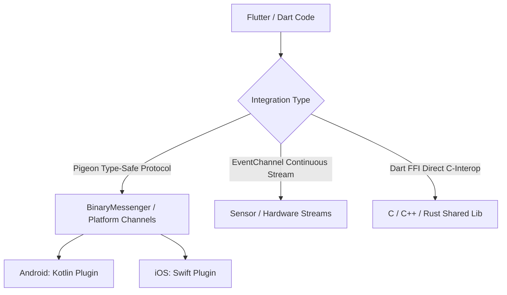

# Flutter Native Platform Bridge Master

This skill provides architecture and integration standards for bridging Flutter with native Android (Kotlin) and iOS (Swift) capabilities, prioritizing type-safe code generation via **Pigeon** and low-latency **Dart FFI**.

---

## 🌉 Communication Architecture

---

## 🎯 Production Invariants

1. **Pigeon Over Raw String Channels**: Always use `pigeon` schema definitions for bidirectional API contracts to prevent runtime string mismatches and casting crashes.
2. **Main Thread Safety**: Always dispatch blocking native code (I/O, database, heavy compute) to native background dispatchers (`Dispatchers.IO` in Kotlin, `DispatchQueue.global()` in Swift) before returning to the Flutter main thread.
3. **Stream Cancellation Handling**: Native `EventChannel.StreamHandler` implementations must gracefully handle `onCancel()` to detach native sensor listeners and prevent background battery drain.
4. **Lifecycle-Aware Cleanup**: Ensure all native listeners and foreground services are bound to Activity/FlutterPlugin lifecycles.

---

## 📋 Prosedur Eksekusi

1. **Pola Definisi Pigeon**:
   - Rujuk spesifikasi di [references/pigeon-spec.md](./references/pigeon-spec.md).
2. **Template Pigeon & Native Handler**:
   - Rujuk template di [resources/pigeon-schema.dart](./resources/pigeon-schema.dart).
3. **Audit Native Dependencies**:
   - Jalankan `bash scripts/verify-native-bridge.sh`.
