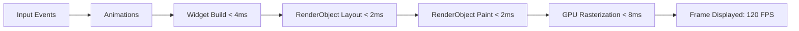

# Flutter Performance & Diagnostics Master

This skill provides systematic profiling and optimization strategies for achieving sustained 60/120 FPS on iOS and Android devices, eliminating memory leaks, and shrinking application binaries.

---

## ⚡ Flutter Rendering Pipeline & Frame Budget

*Frame Budget: Max 8.3ms for 120Hz display, max 16.6ms for 60Hz display.*

---

## 🎯 Production Invariants

1. **Const Constructors Everywhere**: Always mark immutable widgets with `const` to allow Flutter to skip subtrees during dirty widget rebuilds.
2. **Zero Heavy Compute on UI Thread**: Any operation taking > 2ms (JSON parsing, regex scanning, image decoding) must be offloaded to `Isolate.run()` or `compute()`.
3. **Bound Image Memory Caches**: Always set `cacheWidth` and `cacheHeight` on network/asset images to prevent decoding multi-megabyte bitmaps in GPU memory.
4. **Release Mode Optimization**:
   - `flutter build apk --release --split-per-abi --obfuscate --split-debug-info=symbols/`
   - Never measure performance on Debug builds; always profile using `flutter run --profile`.

---

## 📋 Prosedur Eksekusi

1. **Diagnosa DevTools Profiler**:
   - Baca panduan di [references/profiling-runbook.md](./references/profiling-runbook.md).
2. **Template Safe Image Caching**:
   - Rujuk [resources/optimized-image.dart](./resources/optimized-image.dart).
3. **Script Audit Rebuilds**:
   - Jalankan `bash scripts/audit-performance.sh`.
