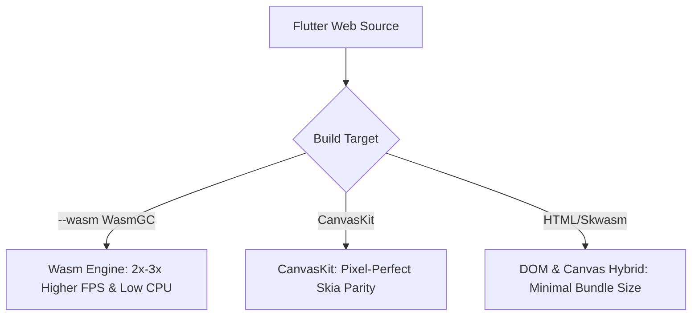

# Flutter Web & PWA Production Mastery

This skill guides high-performance Flutter Web engineering, leveraging cutting-edge **WasmGC (WebAssembly Garbage Collection)**, CanvasKit rendering tuning, PWA offline caching, and responsive web patterns.

---

## 🌐 Web Rendering Matrix & Build Targets

---

## 🎯 Production Invariants

1. **WasmGC Target for Modern Browsers**: Build production web artifacts with `flutter build web --wasm` for dramatic performance improvements and near-native runtime speeds.
2. **Responsive Adaptive Layout**: Never assume fixed mobile dimensions. Wrap layouts with `LayoutBuilder`, and distinguish Mobile (<600px), Tablet (600-1024px), and Desktop (>1024px).
3. **URL Strategy & Routing**: Always configure `usePathUrlStrategy()` from `flutter_web_plugins/url_strategy.dart` to eliminate legacy `#` hash fragments from URLs.
4. **PWA Offline Service Worker**: Customize `web/flutter_service_worker.js` with Cache-First strategies for static font/canvas assets and Network-First for dynamic API calls.

---

## 📋 Prosedur Eksekusi

1. **Panduan Flutter Web & Wasm**:
   - Rujuk panduan di [references/flutter-web-optimization.md](./references/flutter-web-optimization.md).
2. **Template Responsive Layout**:
   - Rujuk template di [resources/responsive-scaffold.dart](./resources/responsive-scaffold.dart).
3. **Verifikasi Web Readiness**:
   - Jalankan `bash scripts/check-web-readiness.sh`.
