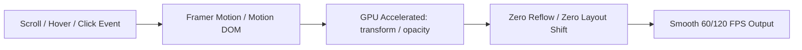

# Modern Web Animation & Framer Motion Master

This skill guides the implementation of fluid, hardware-accelerated animations using **Framer Motion** and **GSAP**, with strict adherence to GPU-only transforms and accessibility standards.

---

## 🚀 GPU Transform Pipeline

---

## 🎯 Production Invariants

1. **Hardware-Accelerated Properties Only**: Animate exclusively `transform` (`x`, `y`, `scale`, `rotate`) and `opacity`. Never animate `width`, `height`, `top`, or `margin` to prevent costly CPU layout recalculations.
2. **Respect Reduced Motion**: Always wrap motion definitions with `useReducedMotion()` or CSS `@media (prefers-reduced-motion)` to protect users prone to motion sickness.
3. **AnimatePresence Exit Keys**: When using `<AnimatePresence>`, every direct child must have a unique, persistent `key` for exit transitions to register properly.
4. **`layoutId` Shared Element Magic**: Leverage `layoutId` for tabs, active indicators, and morphing cards to avoid manual coordinate math.

---

## 📋 Prosedur Eksekusi

1. **Panduan Spring Physics**:
   - Rujuk panduan di [references/spring-physics.md](./references/spring-physics.md).
2. **Template Shared Layout Transition**:
   - Rujuk template di [resources/animated-tabs.tsx](./resources/animated-tabs.tsx).
3. **Audit CSS Motion Leaks**:
   - Jalankan `bash scripts/audit-animations.sh`.
