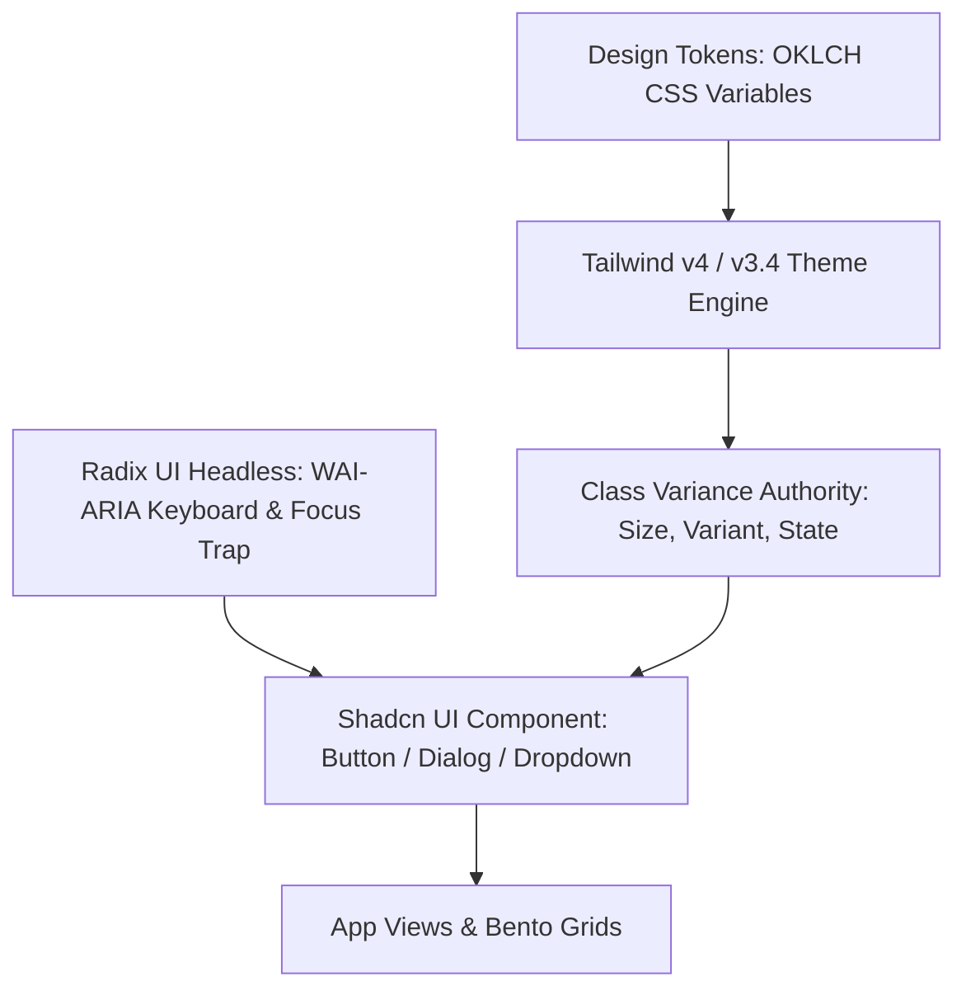

# Tailwind CSS & Shadcn UI Design System Master

This skill provides production standards for architecting accessible, beautiful, headless component libraries using **Tailwind CSS**, **Shadcn UI**, **Radix Primitives**, and **Class Variance Authority (CVA)**.

---

## 🎨 Component Token Architecture

---

## 🎯 Production Invariants

1. **Headless Accessibility Invariant**: Never write custom raw `div` dropdowns or modals without keyboard focus management. Always base interactive primitives on Radix UI or React Aria.
2. **`cn()` Utility Rigor**: Always merge dynamic classes using `twMerge(clsx(inputs))` to ensure Tailwind classes resolve without precedence bugs.
3. **Fluid Typography & Clamp**: Use mathematical CSS clamp scales for fluid headers and containers rather than jarring media-query snap points.
4. **Zero Layout Shift Skeletons**: Every asynchronous component must provide a Skeleton UI that mirrors the exact bounding box of the rendered content.

---

## 📋 Prosedur Eksekusi

1. **Panduan Desain Komponen CVA**:
   - Rujuk panduan di [references/cva-components.md](./references/cva-components.md).
2. **Template Button CVA**:
   - Rujuk [resources/button-component.tsx](./resources/button-component.tsx).
3. **Audit Aksesibilitas & Contrast**:
   - Jalankan `bash scripts/check-tailwind.sh`.
