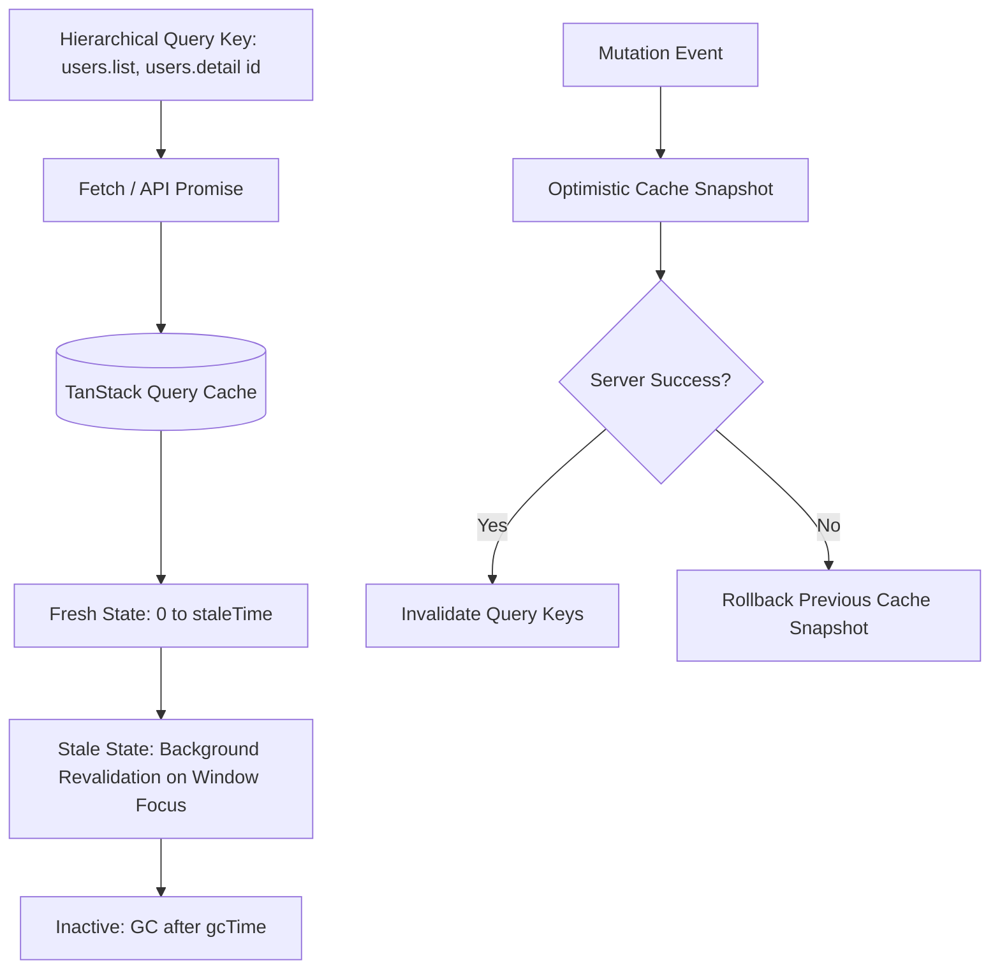

# TanStack Query v5 & State Master

This skill provides best practices for managing server state using **TanStack Query v5 (React Query)** and synchronizing it with local client state using **Zustand**.

---

## 🔄 Cache Lifecycle & Query Key Factory

---

## 🎯 Production Invariants

1. **Strict Query Key Factories**: Never use raw magic strings for query keys (e.g. `['users']`). Always construct structured factories (`userKeys.all`, `userKeys.detail(id)`).
2. **Never Duplicate Server State into Client Stores**: Do not copy query response arrays into Zustand or Redux stores. Read directly from `useQuery`.
3. **Safe Optimistic Updates**: Every optimistic mutation must implement `onMutate` (canceling queries and returning a snapshot), `onError` (rolling back to snapshot), and `onSettled` (invalidating the affected query keys).
4. **Explicit `staleTime`**: Never leave default `staleTime: 0` for slow-changing data. Set thoughtful stale times (e.g. 1-5 minutes) to prevent aggressive refetch storms.

---

## 📋 Prosedur Eksekusi

1. **Panduan Query Key Factory**:
   - Rujuk panduan di [references/query-key-factory.md](./references/query-key-factory.md).
2. **Template Optimistic Mutation**:
   - Rujuk template di [resources/optimistic-mutation.ts](./resources/optimistic-mutation.ts).
3. **Audit Query Cache**:
   - Jalankan `bash scripts/check-query-deps.sh`.
