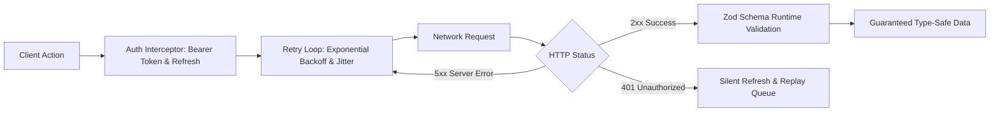

# Web API (REST & GraphQL) Master

This skill provides production standards for architecting reliable, strictly typed client-server communication channels using **REST**, **GraphQL**, **Zod validation**, and resilient interceptors.

---

## 📡 Request/Response Pipeline & Resiliency

---

## 🎯 Production Invariants

1. **Runtime Validation with Zod**: Never trust unvalidated `as MyType` casts on API responses. Always parse via `Schema.parse()` or `Schema.safeParse()` to catch schema drift immediately.
2. **Idempotency on Mutations**: Send `Idempotency-Key` headers on POST/PUT requests to prevent duplicate transactions on network retries.
3. **Silent Token Refresh Queue**: Handle 401 token expiration by holding concurrent failed requests in a pending queue while the refresh token executes, then replay all requests with the fresh token.
4. **GraphQL Query Depth & Complexity Limit**: On GraphQL backends, always limit query depth and complexity to defend against denial-of-service query injections.

---

## 📋 Prosedur Eksekusi

1. **Panduan Interceptor & Refresh**:
   - Rujuk panduan di [references/fetch-interceptor-pattern.md](./references/fetch-interceptor-pattern.md).
2. **Template Type-Safe Fetch Client**:
   - Rujuk template di [resources/api-client-template.ts](./resources/api-client-template.ts).
3. **Audit Schema Validation**:
   - Jalankan `bash scripts/verify-api-contracts.sh`.
