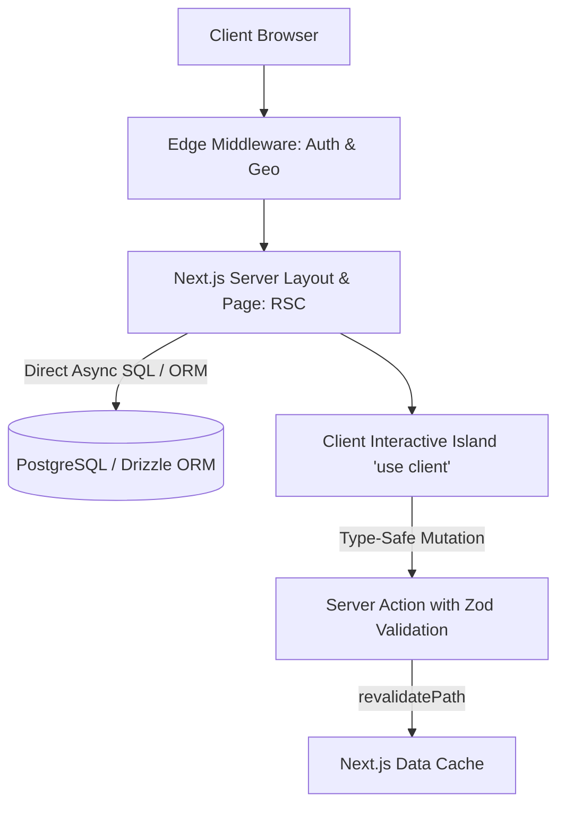

# Web Fullstack Modern Architect Master

This skill provides architectural standards for building fullstack web applications with zero client bundle overhead, React Server Components, streaming SSR, and strictly typed database operations.

---

## ⚡ React Server Components & Data Boundaries

---

## 🎯 Production Invariants

1. **Server Components by Default**: Zero bytes of JavaScript for data-fetching or static presentation. Only add `'use client'` at the leaves of the component tree.
2. **Type-Safe Server Actions**: Validate all server action inputs using Zod or Valibot via `zsa` or `next-safe-action`. Never trust raw client inputs.
3. **No Unbounded Data Fetching**: Always enforce pagination (`limit`/`offset` or cursor-based) in server queries.
4. **Suspense Streaming Over Full-Page Blocking**: Wrap slow network or DB operations in `<Suspense fallback={<Skeleton />}>` to unlock instant Time-To-First-Byte (TTFB).

---

## 📋 Prosedur Eksekusi

1. **Panduan RSC & Server Action**:
   - Rujuk panduan di [references/fullstack-rsc-guide.md](./references/fullstack-rsc-guide.md).
2. **Template Type-Safe Server Action**:
   - Rujuk [resources/server-action-template.ts](./resources/server-action-template.ts).
3. **Audit Server Boundaries**:
   - Jalankan `bash scripts/audit-fullstack.sh`.
