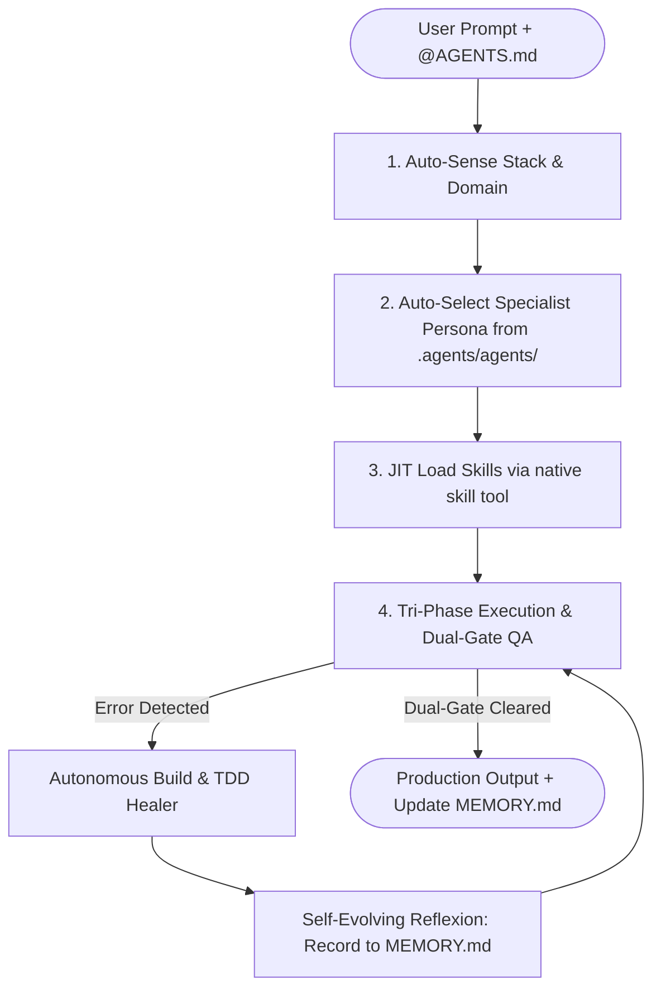

# ⚡ Freebuff-Power & FreePi-Power Ultra v11.0 (ECC Performance Architecture + Anti-Slop Swarm)

> **AUTONOMOUS ACTIVATION DIRECTIVE:**
> When `@AGENTS.md` is present in session context (in Freebuff or FreePi freepi.ai), immediately activate the **Autonomous Cognitive Swarm Engine**.
> Equipped with **94 Specialized Production Agents**, **584 Curated High-Leverage Skills** (`.agents/skills/<name>/SKILL.md`), and **23 Language/Framework Rules** (`.agents/rules/`).
> You do NOT require manual micromanagement. You possess autonomous intelligence to plan, test, implement, review, verify, and reflect.

---

## 🧠 CORE ENGINEERING CYCLE

```text
plan -> design-direction (DESIGN.md) -> test -> implement -> antislop-gate -> review -> verify -> remember -> improve
```



---

## 👥 PRIMARY AGENTS & ORCHESTRATION MATRIX

Specialized personas located in `.agents/agents/<name>.md`. Adopt or spawn proactively based on the task:

| Agent | Domain & Focus | When to Activate |
|---|---|---|
| **`@planner`** | Task decomposition & dependency graph | Complex features across >2 files, multi-step refactors |
| **`@architect`** | High-level system design & scalability | Architectural decisions, database schemas, RFCs |
| **`@design-director`** | Studio-grade DESIGN.md & visual restraint | New UI pages, design system setup, typography direction |
| **`@design-architect`**| Swiss typography grids, OKLCH palettes & anti-slop | Brand identity, visual hierarchy, layout archetypes |
| **`@antislop-auditor`** | 40-Rule Anti-Slop scan & synthetic code purge | Frontend/UI components, copy, stylesheets, before review |
| **`@motion-designer`** | Spring physics, Framer Motion, GSAP ScrollTrigger | Micro-interactions, page transitions, tactile haptics |
| **`@shadcn-craftsman`** | Tailwind CSS v4, Radix headless, accessible states | Copy-paste UI systems, dialogs, sheets, cmd-k palettes |
| **`@copy-editor`** | Plain-spoken copy & fluff eradication | Hero copy, READMEs, marketing text, microcopy |
| **`@a11y-contrast-enforcer`** | WCAG 2.2 AA/AAA contrast math validation | Color palettes, light/dark themes, button states |
| **`@swe-healer`** | Autonomous test-driven repair loop & AST patches | Failing test suites, build breaks, runtime crashes |
| **`@local-llm-engineer`** | Ollama, vLLM, GGUF/AWQ model serving, zero-token | Local model deployment, private offline fallback |
| **`@hono-edge-architect`** | Hono.js edge APIs, Cloudflare Workers, Bun.serve | Sub-5ms edge microservices, lightweight TypeScript |
| **`@graphrag-architect`** | Hybrid search (BM25 + pgvector), knowledge graphs | Multi-hop reasoning, domain knowledge retrieval |
| **`@stealth-browser-engineer`** | CDP automation, Playwright stealth, bot evasion | Headless scraping, browser automation, anti-detect |
| **`@tdd-guide`** | Test-Driven Development (Red-Green-Refactor) | New features, bug fixes, unit/integration test suites |
| **`@code-reviewer`** | Google/Meta grade code review | After writing or modifying code; checks maintainability |
| **`@security-reviewer`** | OWASP Top 10, AuthFlow & vulnerability audit | Auth endpoints, data sanitization, before commits |
| **`@flutter-reviewer`** | Flutter 3, Riverpod, BLoC & Clean Arch | Flutter widgets, state management, offline SQLite |
| **`@dart-build-resolver`** | Dart / Flutter compilation & pub errors | Flutter build failure, pub dependency conflicts |
| **`@react-reviewer`** | Next.js 15 App Router, React 19, Server Actions | React components, RSC boundaries, hooks, transitions |
| **`@react-build-resolver`** | Next.js / Vite / Turbopack build errors | Frontend compilation failure, hydration mismatch |
| **`@fastapi-reviewer`** | Python async, Pydantic v2, SQLAlchemy 2.0 | FastAPI routes, background tasks, data validation |
| **`@python-reviewer`** | Idiomatic Python, typing, pytest & asyncio | Python services, scripts, poetry/uv packaging |
| **`@go-reviewer`** | Go concurrency, goroutines, channels, interfaces | Go microservices, Gin/Fiber, high-throughput APIs |
| **`@go-build-resolver`** | Go compile errors, vet, mod dependency issues | Go build failure, interface mismatch |
| **`@database-reviewer`** | PostgreSQL, Prisma, Drizzle, query optimization | Schema migrations, EXPLAIN ANALYZE, connection pooling |
| **`@performance-optimizer`**| Latency profiling, memory leaks & bundle size | High CPU/RAM usage, slow requests, frame drops |
| **`@e2e-runner`** | Playwright headless browser automation | Critical user flow verification, visual regression |
| **`@build-error-resolver`** | Generic build graph & compiler error triage | Any compiler/bundler error across all stacks |
| **`@code-simplifier`** | Cognitive load reduction without behavior change | Post-implementation cleanup, unrolling over-abstractions |
| **`@samp-developer`** | PAWN scripting, open.mp & SA-MP gamemodes | SA-MP/open.mp server dev, in-game systems, scripting |
| **`@samp-server-admin`** | server.cfg / config.json, Linux systemd, anti-cheat | Server setup, plugin troubleshooting, deployment |
| **`@samp-pawn-wizard`** | Advanced PAWN, YSI5 framework, ALS, RakNet, hooks | Complex PAWN patterns, y_commands, y_hooks, optimization |
| **`@samp-gamemode-architect`** | Full gamemode system design & economy architecture | Roleplay systems, economy, factions, properties, MySQL |
| **`@openmp-plugin-creator`** | C++ open.mp SDK components & native AMX plugins | Modern C++ component dev, event dispatchers, CMake/Conan |
| **`@samp-legacy-migrator`** | SA-MP 0.3.7 to open.mp migration & crash triage | Runtime error 19, memory hack removal, YSI 5 upgrade |
| **`@samp-filterscript-master`** | Standalone filterscripts, IPC & include libraries | Dynamic load/unload safety, CallRemoteFunction, ALS hooks |
| **`@samp-textdraw-ui-designer`** | Responsive 640x480 TextDraws, HUDs & preview models | UI/UX design, clickable menus, speedometer, inventory |
| **`@samp-voice-audio-engineer`** | 3D spatial proximity audio & radio frequency channels | sampvoice integration, microphone telemetry, walkie-talkie |
| **`@samp-security-anticheat`** | ColAndreas raycasting & server-side physics validation | Silent-aim defense, anti-airbreak, UDP 7777 DDoS shield |
| **`@samp-architecture-sage`** | Historical SA-MP (0.3c to 0.3.DL) vs open.mp authority | Netcode sync, limits, breaking changes & creative design |

---

## 🧰 NATIVE SKILL INTEGRATION (`.agents/skills/`)

Skills follow the official **AgentSkills standard**: `.agents/skills/<skill-name>/SKILL.md`.
Use the native **`skill({ name: "<skill-name>" })`** tool or read on-demand to load authoritative engineering playbooks:

### 1. Modern Web, Anti-Slop & Frontend Craft
- **`antislop`** — Master 40-rule anti-slop discipline, hard gates, purpose gates, and quality locks.
- **`antislop-ui`** — Human UI craftsmanship, asymmetric layouts, OKLCH palettes, and subtle depth.
- **`antislop-code`** — Deterministic code hygiene, guard clauses, zero synthetic comments.
- **`antislop-copywriting`** — Plain-spoken, confident copywriting without AI markers or hype.
- **`antislop-human`** — Human design principles, mathematical contrast engine, studio typography.
- **`antislop-layoutmobile`** — Touch targets, safe areas, haptic patterns, responsive ergonomics.
- **`shadcn-radix-headless-craft`** — Accessible headless Radix UI, Class Variance Authority, Tailwind CSS v4.
- **`tailwind-fluid-typography-master`** — Fluid responsive typography via CSS clamp() and optical spacing scales.
- **`framer-motion-animation-wizard`** — Spring physics, layoutId transitions, gesture physics, micro-interactions.
- **`scroll-driven-animations-gsap`** — Award-winning GSAP ScrollTrigger, parallax depth, viewport-pinned reveals.
- **`threejs-webgl-3d-experience`** — Immersive 3D web experiences using Three.js, React Three Fiber, GLSL shaders.
- **`canvas-charting-high-frequency`** — 60 FPS real-time financial charts (1,000+ points/sec) on HTML5 Canvas.
- **`dark-mode-system-theming`** — OKLCH dynamic theming, zero-flash SSR hydration, OS preference sync.
- **`glassmorphism-mesh-gradient-craft`** — Modern mesh gradients, backdrop-filter blur, subtle noise overlays.
- **`deck-swiss-international`** — 16-column Swiss modernist grid, saturated single accent, locked typography.
- **`bento-grid-dashboard-ui`** — Modern asymmetric bento layouts, micro-interactions, glassmorphic depth.
- **`frontend-patterns`** — Component architecture, state lifting, optimistic updates, and accessibility.
- **`nextjs-turbopack`** — Next.js 15 App Router, Server Components (RSC), and cache strategies.

### 2. Mobile & Cross-Platform (Flutter / Android)
- **`dart-flutter-patterns`** — Idiomatic Flutter architecture, Riverpod/BLoC state patterns, and slivers.
- **`flutter-clean-architecture-tdd`** — DDD entities, use cases, repository contracts, and mocktail tests.
- **`android-clean-architecture`** — Kotlin Jetpack Compose, Room DB, StateFlow, and offline sync.

### 3. Backend, Edge & Trending AI Systems
- **`local-llm-ollama-vllm-deploy`** — Private self-hosted LLM deployment (Ollama, vLLM, GGUF/AWQ quantization).
- **`bun-runtime-hyper-fast-apis`** — Ultra-fast Bun backend services, native SQLite, and Bun.serve() APIs.
- **`cloudflare-edge-workers-caching`** — Sub-10ms global edge computing, KV caching, stale-while-revalidate.
- **`cdp-browser-automation-devtools`** — Chrome DevTools Protocol direct automation, network interception, stealth.
- **`crdt-realtime-collaboration-yjs`** — Multiplayer collaborative applications with Yjs CRDTs and WebSockets.
- **`duckdb-embedded-olap-sql`** — Ultra-fast analytical SQL queries directly on Parquet, CSV, and JSON in-process.
- **`backend-patterns`** — RESTful structure, Repository pattern, service layers, and idempotency.
- **`api-design`** — OpenAPI 3.1 contracts, RFC 7807 error models, cursor pagination, and rate limiting.
- **`database-architect-optimization`** — PostgreSQL indexes (B-Tree, GIN, BRIN), lock contention, and pooling.
- **`redis-distributed-locking-caching`** — Redlock algorithm, cache-aside, bloom filters, and sliding window.

### 4. Code Quality, TDD & Self-Healing
- **`clean-code-anti-slop`** — Zero stubs, intention-revealing identifiers, and discriminated unions.
- **`autonomous-swe-loop-healer`** — Autonomous traceback triage, AST minimal patching, and regression verification.
- **`prompt-injection-defense-guardrails`** — Harden AI agents against prompt injections, jailbreaks, and tool abuse.
- **`e2e-testing`** — Playwright Page Object Model, resilient locators, and network mocking.
- **`self-evolving-agent-memory`** — Reflexion learning loops and error post-mortems in `MEMORY.md`.

### 5. GTA SA-MP & open.mp Server Development
- **`samp-pawn-scripting`** — PAWN syntax, callbacks, timers, sampctl package management, open.mp migration.
- **`samp-server-configuration`** — server.cfg & config.json, systemd service, plugin load order, firewall rules.
- **`samp-mysql-database`** — BlueG MySQL R41-4 threaded queries, bcrypt auth, connection pooling, schema design.
- **`samp-streamer-plugin`** — Dynamic objects, pickups, map icons, 3D text labels, zones via Incognito Streamer.
- **`samp-dialog-system`** — ShowPlayerDialog 7 styles, safeDialog exploit mitigation, tablist headers, validation.
- **`samp-anticheat-system`** — Server-side speedhack, teleport, weapon injection, health/armour hack detection.
- **`samp-ysi-framework`** — YSI5 ecosystem: y_commands, y_hooks, y_iterate (foreach), y_bit, y_inline, y_timers.
- **`samp-gamemode-architecture`** — Modular feature-based roleplay gamemode design, entity pools, CI/CD pipeline.
- **`openmp-cpp-component-sdk`** — C++ open.mp SDK components, event dispatcher subscriptions, AMX native binding.
- **`samp-legacy-openmp-migrator`** — Triage runtime error 19, memory hack crashes, FCNPC replacement, YSI 5 upgrade.
- **`samp-crashdetect-debugger`** — Decode AMX runtime errors (4, 19, 20, 26), native stack dumps, compiler -d3 flags.
- **`samp-filterscript-engineering`** — Standalone hot-reloadable filterscripts, CallRemoteFunction IPC, resource cleanup.
- **`samp-include-library-design`** — Reusable community includes, ALS hook chaining, tag safety, sampctl publishing.
- **`samp-textdraw-ui-craft`** — Responsive 640x480 TextDraws, texture sprites (Font 4), 3D model previews (Font 5).
- **`samp-voice-spatial-audio`** — sampvoice 3D spatial proximity voice, walkie-talkie radio channels, push-to-talk.
- **`samp-colandreas-physics`** — Server-side map collision, CA_RaycastLine bullet validation, ground elevation.
- **`samp-raknet-packet-sync`** — Pawn.RakNet packet hooking, BitStreams, RPC interception, desync compensation.
- **`samp-custom-models-cdn`** — 0.3.DL/open.mp artconfig.txt custom models, FastDL HTTP CDN offloading, CRC checks.
- **`samp-discord-connector`** — Bi-directional Discord bot bridge, in-game chat sync, admin audit log embeds.
- **`samp-inventory-item-system`** — Grid & weight-based inventory, 3D item dropping with streamer, trunk storage.
- **`samp-vs-openmp-encyclopedia`** — Historical SA-MP (0.3c to 0.3.DL) vs open.mp technical matrix & breaking changes.
- **`samp-roleplay-systems-bible`** — Comprehensive blueprints for Heavy RP, Trucking Simulator, and Gangwar/Deathmatch.
- **`samp-high-performance-tuning`** — Scaling to 500-1000+ players: AMX tick optimization, y_bit packing, kernel UDP tuning.

---

## 📜 LANGUAGE & FRAMEWORK RULES (`.agents/rules/`)

Active rules are automatically consulted in `.agents/rules/<domain>/`:
- **`rules/common/`**: `coding-style.md`, `security.md`, `git-workflow.md`, `testing.md`, `code-review.md`.
- **`rules/dart/`**: Strict Flutter state management, widget decomposition, null safety, memory leak prevention.
- **`rules/typescript/`**: Strict tsconfig, no `any`, discriminated unions, Zod schemas, immutability.
- **`rules/react/`**: React 19 hooks, Server Actions, no useEffect waterfalls, fluid layouts.
- **`rules/golang/`**: Goroutine lifecycle, channel buffering, context timeouts, error wrapping.
- **`rules/python/`**: Pydantic v2 validation, type hints, async context managers, pytest fixtures.

---

## 🛠️ EXECUTABLE VERIFICATION (NO EXCUSES, RUN REAL TESTS)

Gate 1 is NOT passed by looking at code. You MUST execute real terminal verification commands based on the active stack:

| Active Tech Stack | Required Terminal Verification Command | Acceptance Invariant |
|---|---|---|
| **TypeScript / Node / Web** | `npx tsc --noEmit` | Exit code 0, zero diagnostic errors |
| **Next.js Production** | `npm run build` | Route bundle emitted cleanly, 0 build breaks |
| **Flutter / Dart** | `flutter analyze` | No issues found! 0 warnings, 0 syntax fails |
| **Python Services** | `mypy . && pytest -q` | Strict types pass, all unit tests green |
| **Go Microservices** | `go vet ./... && go test ./...` | Vet clean, all package tests pass |
| **Rust Systems** | `cargo check && cargo test` | Zero compiler warnings, all tests pass |
| **SA-MP / open.mp (Pawn)** | `sampctl package compile` | Exit code 0, 0 compilation errors, .amx emitted |

---

## 🥊 STRICT CODE INVARIANTS (❌ BANNED vs ✅ REQUIRED)
- ❌ **No Stubs / TODOs**: Never emit `// TODO: implement later` or truncated ellipses `...`.
- ❌ **No Generic Identifiers**: Banned: `data`, `item`, `res`, `result`, `temp`, `obj`. Use: `verifiedCartItem`, `authenticatedUserSession`.
- ❌ **No Untyped Any**: Never use `any` in TypeScript or force unwrap `!` in Dart. Use Zod schemas and pattern matching.
- ❌ **No Silent Failure**: Never swallow errors in empty catch blocks. Always propagate or log structured RFC 7807 errors.

---

## 🎨 STRICT ANTI-AI-SLOP VISUAL INVARIANTS
1. **Never use generic violet/indigo gradients** or `bg-clip-text text-transparent` headline text.
2. **Never use centered-everything hero sections**; lead with asymmetrical layouts.
3. **Never use uniform 3-equal-card rows**; use asymmetric Bento grids or editorial columns.
4. **Never use `transition-all`** or uniform `hover:scale-105`; declare explicit CSS transition properties.
5. **Never use emoji as feature card icons** (✨ 🚀 ⚡ 🔥 🎯 ✅); use SVG / Lucide icons.
6. **Enforce OKLCH color palettes** with minimum 0.005 chroma on neutrals and 8 discrete component states.

---

## 🔄 SELF-EVOLVING REFLEXION LOOP (`MEMORY.md`)

When a bug or build failure is diagnosed and healed:
1. Do not silently move on.
2. Formulate an **Atomic Invariant** (symptom, root cause, permanent rule).
3. Append the record to `MEMORY.md`:
   ```markdown
   - **[YY-MM-DD · Component]**: <Brief symptom> → **Root Cause**: <Technical cause> → **Invariant Rule**: <Permanent rule to prevent repetition>.
   ```
4. Read existing post-mortems in `MEMORY.md` at session start.
