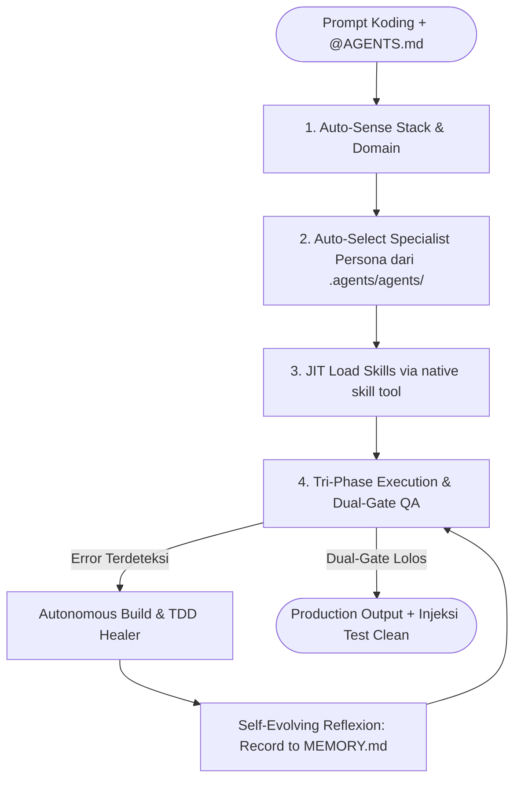

<div align="center">

# ⚡ FREEBUFF-POWER & FREEPI-POWER SUPREME SUITE (v11.2)
### Autonomous Cognitive Swarm with 99 Production Agents, 591 Curated Skills, Native FreePi (freepi.ai) Engine, FiveM-Style SA-MP / open.mp 2026 Studio (MLO, ox_target, ox_lib, ox_inventory, FiveM TextDraw) & Anti-Ban

[](https://opensource.org/licenses/MIT)
[](https://freepi.ai)
[](#-roster-99-specialized-production-agents)
[](#-katalog-591-modular-skills)
[](#3--gta-sa-mp--openmp-supreme-suite)
[](#-autonomous-swe-bench-evaluator)
[](#-proteksi-anti-ban--stealth-sandbox)
[](#-instalasi-instan-1-line-universal-dual-installer)

```
  ______ _____  ______ ______ _____ _____      _____   ______          ________ _____  
 |  ____|  __ \|  ____|  ____|  __ \_   _|    |  __ \ / __ \ \        / /  ____|  __ \ 
 | |__  | |__) | |__  | |__  | |__) || |______| |__) | |  | \ \  /\  / /| |__  | |__) |
 |  __| |  _  /|  __| |  __| |  ___/ | |______|  ___/| |  | |\ \/  \/ / |  __| |  _  / 
 | |    | | \ \| |____| |____| |    _| |_     | |    | |__| | \  /\  /  | |____| | \ \ 
 |_|    |_|  \_\______|______|_|   |_____|    |_|     \____/   \/  \/   |______|_|  \_\
```

**Freebuff-Power & FreePi-Power v11.0** menghadirkan arsitektur **Dual-Identity Cognitive Swarm** paling komprehensif di dunia: menggabungkan inferensi cloud gratis tanpa dompet dari [FreePi (freepi.ai)](https://freepi.ai/) dengan kekuatan engine Freebuff yang dilengkapi **94 Specialized Production Agents**, **584 Curated Modular Skills**, **GTA SA-MP & open.mp Supreme Suite**, **40-Rule Anti-Slop Linter**, **Autonomous SWE-Healer**, **Local Offline Zero-Token Ollama Engine**, **Multi-Account Vault**, dan **Stealth Anti-Detect Sandbox**.

[Instalasi Dual 1 Baris](#-instalasi-instan-1-line-universal-dual-installer) • [Integrasi FreePi](#1--integrasi-freepi-freepiai--dual-identity) • [GTA SA-MP & open.mp Suite](#8--gta-sa-mp--openmp-supreme-suite) • [Panduan CLI Lengkap](#-cli-command-palette-v110) • [Roster 94 Sub-Agents](#-roster-94-specialized-production-agents) • [Katalog 584 Skills](#-katalog-584-modular-skills)

</div>

---

## ⚡ Instalasi Instan (1-Line Universal Dual Installer)

Cukup jalankan **satu baris perintah** berikut di terminal Linux atau macOS Anda. Perintah ini otomatis memasang **KEDUA CLI** (`freebuff-power` dan `freepi-power`) sekaligus beserta seluruh 94 agents dan 584 skills:

### Menggunakan cURL:
```bash
curl -fsSL https://raw.githubusercontent.com/FerzDevZ/freebuff-power/main/install.sh | bash
```

### Menggunakan Wget:
```bash
wget -qO- https://raw.githubusercontent.com/FerzDevZ/freebuff-power/main/install.sh | bash
```

> **Catatan:** Skrip installer otomatis mendeteksi shell (`bash`, `zsh`, `profile`), menyinkronkan 94 agen & 584 skills ke `~/.agents/` dan `~/.freebuff-superpower/`, menyambungkan engine FreePi (`free-pi-cli`), mengompilasi hook stealth anti-ban C, dan mengekspor `$PATH` secara instan tanpa perlu reboot.

---

## 🧠 Core Engineering Cycle

```text
plan ➔ design-direction (DESIGN.md) ➔ test ➔ implement ➔ antislop-gate ➔ review ➔ verify ➔ remember ➔ improve
```



---

## 🌟 Fitur Unggulan v11.0

### 1. ⚡ Integrasi Native FreePi (freepi.ai) & Session Manager
* **100% Native FreePi Routing (Zero Leakage ke Freebuff):** Seluruh perintah `freepi-power` langsung mengarah ke `free-pi-cli` (termasuk `session`, `continue`, `fresh`, `import`, `login`, `logout`, `redeem`, `mcp`, `hive`, `remote`).
* **FreePi Session Manager & Skill Packs:**
  ```bash
  freepi-power start                 # Mulai sesi FreePi + injeksi AGENTS.md & 97 slash agents
  freepi-power session               # Lihat daftar semua sesi FreePi tersimpan (ID, model, prompt)
  freepi-power session <uuid>        # Lanjutkan sesi FreePi spesifik berdasarkan UUID
  freepi-power continue              # Lanjutkan sesi terakhir di folder aktif (--continue)
  freepi-power commands              # Cheatsheet lengkap CLI & /slash command di dalam FreePi
  freepi-power pack samp             # Aktifkan 8 skill inti SA-MP 2026 & FiveM TextDraw (hemat kredit)
  ```
* **Native Slash-Command Agents di Dalam FreePi:** Seluruh 97 agen tersinkron otomatis ke `~/.free-pi/agent/prompts/` sehingga bisa langsung dipanggil saat chat FreePi dengan `/samp-textdraw-fivem-master`, `/samp-modern-jobs-architect`, atau `/samp-creator-2026`.

### 2. 🎨 Studio Anti-Slop & Human Design Purger
* **Audit Anti-Slop 40 Aturan:** Pindai kode, styling, dan teks dari elemen generik AI (*purple/indigo gradient, 3-card layout, stubs `// TODO`, buzzwords*) via:
  ```bash
  freepi-power antislop audit .
  ```
* **Verifikasi Kontras Matematis WCAG 2.2 AAA:**
  ```bash
  freepi-power contrast "#0A0A0A" "#FFFFFF"
  ```
* **Inisialisasi Panduan Desain Bertaraf Studio:**
  ```bash
  freepi-power design init
  ```

### 3. 🎮 GTA SA-MP & open.mp Supreme Suite
Suite terintegrasi terlengkap di dunia untuk pengembang server SA-MP dan open.mp (Pawn & C++):
* **Deep Code Linter (`samp audit`):**
  Pindai ribuan baris script Pawn untuk mendeteksi kejahatan lag di `OnPlayerUpdate`, loop `MAX_PLAYERS` lambat, command parser kuno `strcmp`, dan celah SQL Injection:
  ```bash
  freepi-power samp audit ./gamemodes
  ```
* **Autonomous Pawn Compiler & Healer (`samp heal`):**
  Kompilasi Pawn via `pawncc` atau `sampctl`, tangkap error syntax / tag-mismatch / missing include, dan perbaiki kode otomatis:
  ```bash
  freepi-power samp heal gamemodes/main.pwn
  ```
* **Instant Project Scaffolder (`samp new`):**
  Buat gamemode modern lengkap dengan modular YSI 5, BlueG MySQL R41-4, Bcrypt auth, dan konfigurasi `config.json` dalam 1 detik:
  ```bash
  freepi-power samp new openmp my-openmp-server
  # atau gamemode roleplay heavy:
  freepi-power samp new samp-rp my-roleplay-server
  ```
* **Kitab Perbandingan Teknis SA-MP vs open.mp (`samp vs`):**
  Buka panduan perbandingan teknis arsitektur, breaking changes, entity pool, native functions, dan plugin vs component:
  ```bash
  freepi-power samp vs
  ```

### 4. 🩺 Autonomous SWE-Healer (`heal`)
* Jalankan tes proyek (`npm test`, `pytest`, `cargo test`, `go test`) dan biarkan AI memperbaiki kegagalan koding secara mandiri:
  ```bash
  freepi-power heal "npm test"
  ```
* AI menganalisis error traceback $\rightarrow$ mengisolasi file penyebab $\rightarrow$ menerapkan patch minimal $\rightarrow$ memverifikasi ulang hingga hijau (Green).

### 5. 💻 Local Offline LLM Engine (`local`)
* Koding tanpa internet, 100% gratis, zero-cost, dan kebal ban selamanya menggunakan model Ollama lokal:
  ```bash
  freepi-power local qwen2.5-coder:14b
  ```
* Kompatibel dengan `qwen2.5-coder`, `deepseek-coder-v2`, `llama3.3`, dan model GGUF/AWQ lainnya.

### 6. 👥 Multi-Account Vault & Round-Robin Quota Rotation
* Simpan banyak akun ke dalam vault terisolasi:
  ```bash
  freebuff-power account new akun1
  freebuff-power account new akun2
  ```
* Beralih akun dalam 0.1 detik saat akun aktif mendekati limit:
  ```bash
  freebuff-power rotate
  freebuff-power account auto
  ```
* **Pembersihan Identitas Total (Zero Correlation):**
  ```bash
  freebuff-power reset-full
  ```

### 7. 🛡️ Proteksi Anti-Ban & Stealth Sandbox
* **Zero Fingerprint Linkage:** Pemalsuan Machine-ID Linux, D-Bus ID, MAC address virtual, dan serial perangkat via C-hook `libfreebuff-stealth.so` (LD_PRELOAD).
* **Disposable Chrome Sandbox:**
  ```bash
  freebuff-power browser stealth
  ```
  Otomatis memalsukan Canvas, WebGL, AudioContext farbling, WebRTC leak shield, dan auto-wipe tanpa bekas saat ditutup.

### 8. 🔄 Universal IDE Matrix Sync (`sync`)
* Ekspor seluruh 94 Sub-Agents dan 584 Skills ke seluruh editor AI di laptop Anda:
  ```bash
  freepi-power sync --all
  ```
  Mendukung: Cursor (`.cursorrules`), Windsurf (`.windsurfrules`), Claude Code (`CLAUDE.md`), Cline/Roo-Code (`.clinerules`), GitHub Copilot, dan ZCode (`~/.zcode/`).

---

## 📋 CLI Command Palette (v11.1)

| Kategori | Perintah | Deskripsi & Fungsi |
|---|---|---|
| **FreePi Native CLI** | `freepi-power start` | **[REKOMENDASI]** Mulai sesi FreePi + injeksi AGENTS.md & 97 slash agents. |
| | `freepi-power session [id]` | Tanpa ID: daftar semua sesi tersimpan; dengan ID: lanjutkan `--session <id>`. |
| | `freepi-power continue` | Lanjutkan sesi FreePi terakhir di folder aktif (`--continue`). |
| | `freepi-power fresh` | Mulai sesi FreePi baru yang bersih (`--new`). |
| | `freepi-power import [claude\|codex]` | Impor & lanjutkan sesi Claude Code / Codex ke FreePi. |
| | `freepi-power login` / `logout` | Login GitHub via device code (`--device-login`) atau keluar. |
| | `freepi-power mcp <cmd>` | Kelola MCP server FreePi (`add`, `list`, `remove`, `login`). |
| | `freepi-power commands` | Tampilkan semua CLI flag & `/slash` command di dalam FreePi. |
| | `freepi-power pack [samp\|web\|list]` | Aktifkan skill pack native ke `~/.free-pi/agent/skills/` (hemat kredit). |
| **Freebuff & Offline** | `freebuff-power start` | **[STEALTH]** Reset telemetry + injeksi 97 agents & 588 skills + sesi Freebuff. |
| | `freepi-power local [model]` | **[OFFLINE]** Koding 100% gratis via Ollama lokal tanpa kuota dan kebal ban. |
| | `freepi-power heal [test_cmd]`| **[AUTO-HEALER]** Jalankan test runner & perbaiki error kode secara mandiri. |
| | `freepi-power ui` | Buka Interactive Terminal TUI Dashboard (pilih agen/skill visual). |
| **GTA SA-MP & open.mp** | `freepi-power samp audit [dir]` | Pindai OnPlayerUpdate lag, strcmp kuno, dan kerentanan SQL injection. |
| | `freepi-power samp heal [file]` | Kompilasi Pawn via pawncc & perbaiki syntax / missing include otomatis. |
| | `freepi-power samp new openmp` | Scaffold open.mp gamemode modern (YSI 5 + MySQL R41-4 + Bcrypt). |
| | `freepi-power samp new samp-rp` | Scaffold Heavy Roleplay gamemode modular siap produksi. |
| | `freepi-power samp vs` | Buka Kitab Perbandingan Teknis SA-MP legacy vs modern open.mp. |
| **Anti-Slop & Desain** | `freepi-power antislop audit .`| Pindai 40 aturan AI slop, gradien ungu, buzzwords, dan komentar sampah. |
| | `freepi-power design init` | Settle direction before building: buat file `DESIGN.md` bertaraf studio. |
| | `freepi-power contrast <fg> <bg>`| Hitung matematis rasio kontras WCAG 2.2 AA/AAA (Wajib 4.5:1 / 7:1). |
| **Keamanan & DevOps** | `freepi-power pentest [dir]` | Pindai celah OWASP Top 10, kebocoran secret API, dan CVE dependensi. |
| | `freepi-power sync / export` | Ekspor 97 agents & 588 skills ke Cursor, Windsurf, Claude Code, FreePi. |
| | `freepi-power snapshot save <nama>`| Buat checkpoint shadow proyek sebelum AI merombak kode. |
| | `freepi-power rollback` | Batalkan kesalahan AI & pulihkan proyek ke kondisi semula (0.5 detik). |
| | `freepi-power doctor` | Pemeriksaan kesehatan sistem (FreePi, Freebuff, 97 agents, 588 skills). |

---

## 👥 Roster 99 Specialized Production Agents

Katalog lengkap persona spesialis dalam `.agents/agents/<nama>.md` (dan otomatis tersedia sebagai `/slash-command` di dalam FreePi!):

### 🎮 GTA SA-MP & open.mp FiveM-Style 2026 Master Suite (16 Agents)
1. **`@samp-textdraw-fivem-master`**: Master TextDraw FiveM / NoPixel / QBox / Ox_lib (rounded `LD_BEAT:chit`, 16:9 math, HUD, Speedo, Toast, Skill-Check, Polar Radial Wheel, Hotbar `[1-5]`).
2. **`@samp-mapping-mlo-architect`**: Master MLO Mapping & Dynamic Objects (`SetDynamicObjectMaterial`/`MaterialText`, anti-fall `Streamer_UpdateEx`, `ox_doorlock`, Dynamic Actors, vehicle/player props, live furniture editor).
3. **`@samp-fivem-systems-engineer`**: Master FiveM-to-PAWN Systems (`ox_target` Third-Eye camera raycast, `ox_lib` Notify/ProgressBar/SkillCheck/Radial, `ox_inventory` Grid+Metadata+Hotbar+Anti-Dupe & `QBox` state guards).
4. **`@samp-modern-jobs-architect`**: Arsitek Job Modern 2026 & Ekonomi Tertutup (FSM multi-stage jobs, minigame, Co-op Party, dynamic market, anti-exploit).
5. **`@samp-creator-2026`**: Full-Stack Server Creator 2026 (FiveM UX di PAWN, `[E]`/`[Y]` proximity interaction, Smartphone/MDT, PC + SA-MP Mobile Android).
4. **`@samp-developer`**: Lead Developer SA-MP & open.mp (Pawn & modern architecture).
5. **`@samp-server-admin`**: Sysadmin & Server Operations (Linux systemd, `server.cfg`, `config.json`).
6. **`@samp-pawn-wizard`**: Expert Advanced PAWN (YSI 5 framework, ALS hooks, RakNet, y_timers).
7. **`@samp-gamemode-architect`**: Gamemode Systems Architect (Heavy RP, economy, MySQL pooling).
8. **`@openmp-plugin-creator`**: Native C++ Component & Plugin Developer (open.mp SDK, CMake).
9. **`@samp-legacy-migrator`**: Migration Specialist (SA-MP 0.3.7 $\rightarrow$ open.mp, error 19 triage).
10. **`@samp-filterscript-master`**: Filterscript Engineer (Dynamic hot-reloading, IPC, ALS chaining).
11. **`@samp-textdraw-ui-designer`**: UI/UX Designer (640x480 responsive TextDraws, preview models).
12. **`@samp-voice-audio-engineer`**: 3D Spatial Audio & Voice Engineer (sampvoice, walkie-talkie).
13. **`@samp-security-anticheat`**: Server-Side Anti-Cheat Engineer (ColAndreas raycasting, packet validation).
14. **`@samp-architecture-sage`**: Historical Authority & Tech Encyclopedist (SA-MP vs open.mp breaking changes).

### 🏛️ Core Architecture & Planning (6 Agents)
12. **`@planner`**: Task decomposition & dependency graph.
13. **`@architect`**: High-level system design & RFCs.
14. **`@swe-healer`**: Autonomous test-driven repair loop & AST patches.
15. **`@code-simplifier`**: Cognitive load reduction without behavior change.
16. **`@code-reviewer`**: Google/Meta grade code review.
17. **`@security-reviewer`**: OWASP Top 10 & AuthFlow audit.

### 🎨 Design & Human Interface (7 Agents)
18. **`@design-director`**: Studio-grade DESIGN.md & visual restraint.
19. **`@design-architect`**: Swiss typography grids, OKLCH palettes & anti-slop.
20. **`@antislop-auditor`**: 40-Rule Anti-Slop scan & synthetic code purge.
21. **`@motion-designer`**: Spring physics, Framer Motion, GSAP ScrollTrigger.
22. **`@shadcn-craftsman`**: Tailwind CSS v4, Radix headless, accessible states.
23. **`@copy-editor`**: Plain-spoken copy & fluff eradication.
24. **`@a11y-contrast-enforcer`**: WCAG 2.2 AA/AAA contrast math validation.

### ⚡ Backend, Edge & Database (20+ Agents)
25. **`@hono-edge-architect`**: Hono.js edge APIs, Cloudflare Workers, Bun.serve.
26. **`@fastapi-reviewer`**: Python async, Pydantic v2, SQLAlchemy 2.0.
27. **`@go-reviewer`**: Go concurrency, goroutines, channels, interfaces.
28. **`@database-reviewer`**: PostgreSQL, Prisma, Drizzle, query optimization.
29. **`@local-llm-engineer`**: Ollama, vLLM, GGUF/AWQ model serving.
30. **`@graphrag-architect`**: Hybrid search (BM25 + pgvector), knowledge graphs.
... *dan 64 agen spesialis lainnya yang siap diaktifkan sesuai kebutuhan domain.*

---

## 🧰 Katalog 591 Modular Skills

Seluruh skill tersimpan rapi mengikuti standar resmi **AgentSkills** di `.agents/skills/<nama>/SKILL.md`:

* **GTA SA-MP & open.mp FiveM-Style 2026 (30 Skills):** `samp-mapping-dynamic-objects-pro`, `samp-fivem-oxlib-target-logic`, `samp-fivem-inventory-metadata`, `samp-textdraw-fivem-modern-design`, `samp-modern-jobs-2026-logic`, `samp-modern-creator-2026`, `samp-mobile-android-cef-ui`, `samp-vs-openmp-encyclopedia`, `samp-roleplay-systems-bible`, `samp-high-performance-tuning`, `samp-textdraw-ui-craft`, `samp-voice-spatial-audio`, `samp-colandreas-physics`, `samp-raknet-packet-sync`, `samp-custom-models-cdn`, `samp-discord-connector`, `samp-inventory-item-system`, `openmp-cpp-component-sdk`, `samp-legacy-openmp-migrator`, `samp-crashdetect-debugger`, `samp-filterscript-engineering`, `samp-include-library-design`, `samp-pawn-scripting`, `samp-server-configuration`, `samp-mysql-database`, `samp-streamer-plugin`, `samp-dialog-system`, `samp-anticheat-system`, `samp-ysi-framework`, `samp-gamemode-architecture`.
* **Anti-Slop & Desain (10 Skills):** `antislop`, `antislop-ui`, `antislop-code`, `antislop-copywriting`, `antislop-human`, `antislop-layoutmobile`, `shadcn-radix-headless-craft`, `tailwind-fluid-typography-master`, `framer-motion-animation-wizard`, `deck-swiss-international`.
* **Frontend & Web Apps (50+ Skills):** `nextjs-turbopack`, `frontend-patterns`, `react19-nextjs15-modern-craft`, `threejs-webgl-3d-experience`, `bento-grid-dashboard-ui`, `canvas-charting-high-frequency`.
* **Backend & Systems (70+ Skills):** `bun-runtime-hyper-fast-apis`, `cloudflare-edge-workers-caching`, `golang-concurrency-patterns`, `fastapi-patterns`, `duckdb-embedded-olap-sql`, `redis-distributed-locking-caching`.
* **Security & TDD (40+ Skills):** `security-review`, `tdd-master`, `e2e-testing`, `prompt-injection-defense-guardrails`, `sast-dast-container-cve-scanner`.

---

## 📄 Lisensi

Didistribusikan di bawah lisensi terbuka [MIT License](LICENSE). Bebas digunakan, dimodifikasi, dan didistribusikan untuk proyek komersial maupun personal.
