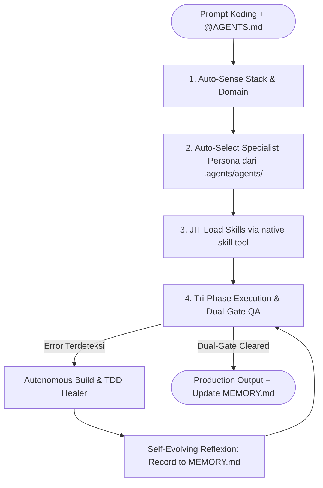

<div align="center">

# ⚡ FREEBUFF-POWER (Hyper-Modern Edition v11.0)
### Autonomous Cognitive Swarm Engine with 90 Production Agents, 574 Curated Skills, Anti-Slop Suite, Offline Local LLM & Enterprise Anti-Ban

[](https://opensource.org/licenses/MIT)
[](#-roster-90-specialized-production-agents)
[](#-katalog-574-modular-skills)
[](#-autonomous-swe-bench-evaluator)
[](#-proteksi-anti-ban--stealth-sandbox)
[](#-instalasi-instan-1-line-installer)

```
  ______ _____  ______ ______ ____  _    _ ______ ______   _____   ______          ________ _____  
 |  ____|  __ \|  ____|  ____|  _ \| |  | |  ____|  ____| |  __ \ / __ \ \        / /  ____|  __ \ 
 | |__  | |__) | |__  | |__  | |_) | |  | | |__  | |__    | |__) | |  | \ \  /\  / /| |__  | |__) |
 |  __| |  _  /|  __| |  __| |  _ <| |  | |  __| |  __|   |  ___/| |  | |\ \/  \/ / |  __| |  _  / 
 | |    | | \ \| |____| |____| |_) | |__| | |    | |      | |    | |__| | \  /\  /  | |____| | \ \ 
 |_|    |_|  \_\______|______|____/ \____/|_|    |_|      |_|     \____/   \/  \/   |______|_|  \_\
```

**Freebuff-Power v11.0** mengubah Freebuff menjadi **Autonomous Cognitive Swarm** paling tangguh di dunia: dilengkapi **90 Production Agents**, **574 Curated Modular Skills**, **Anti-Slop Delivery Gate**, **GTA SA-MP/open.mp Suite**, **Autonomous SWE Healer**, **Local Offline Zero-Token Ollama Engine**, **Multi-Account Vault**, dan **Stealth Anti-Detect Sandbox**.

[Instalasi 1 Baris](#-instalasi-instan-1-line-installer) • [Fitur Unggulan v11.0](#-fitur-unggulan-v110) • [Panduan CLI Lengkap](#-cli-command-palette-v110) • [Multi-Account Vault](#-multi-account-vault--rotasi-kuota) • [Roster 90 Sub-Agents](#-roster-90-specialized-production-agents) • [Katalog 574 Skills](#-katalog-574-modular-skills)

</div>

---

## ⚡ Instalasi Instan (1-Line Universal Installer)

Salin dan jalankan **satu baris perintah** ini di terminal Linux atau macOS Anda:

### Menggunakan cURL:
```bash
curl -fsSL https://raw.githubusercontent.com/FerzDevZ/freebuff-power/main/install.sh | bash
```

### Menggunakan Wget:
```bash
wget -qO- https://raw.githubusercontent.com/FerzDevZ/freebuff-power/main/install.sh | bash
```

> **Catatan:** Skrip installer otomatis mendeteksi shell (`bash`, `zsh`, `profile`), menyinkronkan 90 agen & 574 skills, mengompilasi hook stealth anti-ban C, dan mengekspor `$PATH` secara instan tanpa perlu reboot.

---

## 🧠 Core Engineering Cycle

```text
plan ➔ design-direction (DESIGN.md) ➔ test ➔ implement ➔ antislop-gate ➔ review ➔ verify ➔ remember ➔ improve
```



---

## 🌟 Fitur Unggulan v11.0

### 1. 🎨 Studio Anti-Slop & Human Design Purger
* **Audit Anti-Slop 40 Aturan:** Pindai kode, styling, dan teks dari elemen generik AI (*purple/indigo gradient, 3-card layout, stubs `// TODO`, buzzwords*) via:
  ```bash
  freebuff-power antislop audit .
  ```
* **Verifikasi Kontras Matematis WCAG 2.2 AAA:**
  ```bash
  freebuff-power contrast "#0A0A0A" "#FFFFFF"
  ```
* **Inisialisasi Panduan Desain Bertaraf Studio:**
  ```bash
  freebuff-power design init
  ```

### 2. 🩺 Autonomous SWE-Healer (`freebuff-power heal`)
* Jalankan tes proyek (`npm test`, `pytest`, `cargo test`, `go test`) dan biarkan AI memperbaiki kegagalan koding secara mandiri:
  ```bash
  freebuff-power heal "npm test"
  ```
* AI menganalisis error traceback $\rightarrow$ mengisolasi file penyebab $\rightarrow$ menerapkan patch minimal $\rightarrow$ memverifikasi ulang hingga hijau (Green).

### 3. 💻 Local Offline LLM Engine (`freebuff-power local`)
* Koding tanpa internet, 100% gratis, zero-cost, dan kebal ban selamanya menggunakan model Ollama lokal:
  ```bash
  freebuff-power local qwen2.5-coder:14b
  ```
* Kompatibel dengan `qwen2.5-coder`, `deepseek-coder-v2`, `llama3.3`, dan model GGUF/AWQ lainnya.

### 4. 👥 Multi-Account Vault & Round-Robin Quota Rotation
* Simpan banyak akun ke dalam vault terisolasi:
  ```bash
  freebuff-power account new akun1
  freebuff-power account new akun2
  ```
* Beralih akun dalam 0.1 detik saat akun aktif mendekati limit:
  ```bash
  freebuff-power rotate
  # atau otomatis pilih akun yang siap:
  freebuff-power account auto
  ```
* **Pembersihan Identitas Total (Zero Correlation):**
  ```bash
  freebuff-power reset-full
  ```

### 5. 🛡️ Proteksi Anti-Ban & Stealth Sandbox
* **Zero Fingerprint Linkage:** Pemalsuan Machine-ID Linux, D-Bus ID, MAC address virtual, dan serial perangkat via C-hook `libfreebuff-stealth.so` (LD_PRELOAD).
* **Disposable Chrome Sandbox:**
  ```bash
  freebuff-power login
  # atau
  freebuff-power browser stealth
  ```
  Otomatis memalsukan Canvas, WebGL, AudioContext farbling, WebRTC leak shield, dan auto-wipe tanpa bekas saat ditutup.

### 6. 🔄 Universal IDE Matrix Sync (`freebuff-power sync`)
* Ekspor seluruh 90 Sub-Agents dan 574 Skills ke seluruh editor AI di laptop Anda:
  ```bash
  freebuff-power sync --all
  ```
  Mendukung: Cursor (`.cursorrules`), Windsurf (`.windsurfrules`), Claude Code (`CLAUDE.md`), Cline/Roo-Code (`.clinerules`), GitHub Copilot, dan ZCode (`~/.zcode/`).

### 7. 🛡️ AppSec OWASP & Deep Vulnerability Scanner (`freebuff-power pentest`)
* Audit keamanan kilat terhadap codebase sebelum commit atau deploy:
  ```bash
  freebuff-power pentest .
  ```
  Mendeteksi kebocoran secret API key, risiko XSS/eval, konfigurasi `.env` bocor, dan advisory CVE dependensi.

---

## 📋 CLI Command Palette (v11.0)

| Kategori | Perintah | Deskripsi & Fungsi |
|---|---|---|
| **Koding & Peluncuran** | `freebuff-power start` | **[REKOMENDASI]** Reset telemetry + injeksi 90 agents & 574 skills + buka sesi interaktif. |
| | `freebuff-power local [model]` | **[OFFLINE]** Koding 100% gratis via Ollama lokal tanpa kuota dan kebal ban. |
| | `freebuff-power heal [test_cmd]`| **[AUTO-HEALER]** Jalankan test runner & perbaiki error kode secara mandiri. |
| | `freebuff-power ui` | Buka Interactive Terminal TUI Dashboard (pilih agen/skill visual ala lazygit). |
| | `freebuff-power compose <task>` | Analisis arsitektur tugas & racik kombinasi 3 skill paling relevan. |
| | `freebuff-power spawn <agent>` | Luncurkan sesi Freebuff dengan persona spesifik (misal: `spawn architect`). |
| | `freebuff-power run proxy [model]`| Pilih model FREE (GLM 5.3 / DeepSeek) & koding via proxy lokal. |
| **Anti-Slop & Desain** | `freebuff-power antislop audit .`| Pindai 40 aturan AI slop, gradien ungu, buzzwords, dan komentar sampah. |
| | `freebuff-power design init` | Settle direction before building: buat file `DESIGN.md` bertaraf studio. |
| | `freebuff-power contrast <fg> <bg>`| Hitung matematis rasio kontras WCAG 2.2 AA/AAA (Wajib 4.5:1 / 7:1). |
| **Multi-Account Vault** | `freebuff-power account new <nama>`| Wizard 1-Click onboard akun baru (Chrome Sandbox + Vault). |
| | `freebuff-power account save <nama>`| Simpan sesi login akun aktif ke dalam vault aman. |
| | `freebuff-power account list` | Lihat daftar akun tersimpan di vault beserta status kuotanya. |
| | `freebuff-power account switch <nama>`| Beralih ke akun lain dalam 0.1 detik (Instant Quota Swap). |
| | `freebuff-power rotate` | Putar ke akun berikutnya secara otomatis (Round-Robin Rotator). |
| | `freebuff-power reset-full` | **Reset TOTAL 7-Fase** seluruh token login, sesi, hardware & sterilkan browser. |
| **Keamanan & DevOps** | `freebuff-power pentest [dir]` | Pindai celah OWASP Top 10, kebocoran secret API, dan CVE dependensi. |
| | `freebuff-power sync / export` | Ekspor 90 agents & 574 skills ke Cursor, Windsurf, Claude Code, Cline. |
| | `freebuff-power snapshot save <nama>`| Buat checkpoint shadow proyek sebelum AI merombak kode. |
| | `freebuff-power rollback` | Batalkan kesalahan AI & pulihkan proyek ke kondisi semula (0.5 detik). |
| | `freebuff-power share [port]` | Buka HTTPS Public Tunnel & Live Preview ke HP (via Cloudflare). |
| | `freebuff-power doctor` | Pemeriksaan kesehatan sistem (integritas 90 agents & 574 skills). |

---

## 👥 Roster 90 Specialized Production Agents

Semua agen siap dipanggil di prompt obrolan menggunakan sintaks `@<nama-agent>`:

```text
@architect buatkan topologi microservice Go dengan Kafka dan Redis
@design-architect rancang sistem visual Bento Grid dengan palet OKLCH
@swe-healer perbaiki kegagalan unit test pada module authentication
@shadcn-craftsman buatkan dialog modal accessible dengan Tailwind CSS v4
@samp-developer buatkan modular auth system dengan bcrypt dan MySQL R41-4
@samp-gamemode-architect rancang sistem dynamic vehicle dealership dengan open.mp
```

| Sub-Agent | Domain & Keahlian Khusus |
|---|---|
| `@planner` | Task decomposition, dependency graphs & multi-step refactor plans |
| `@architect` | High-level system design, scalability, database schemas & RFCs |
| `@design-director` | Studio-grade DESIGN.md, visual restraint & typography systems |
| `@design-architect` | Swiss typography grids, OKLCH color palettes & anti-slop visual hierarchy |
| `@antislop-auditor` | 40-Rule Anti-Slop scan, synthetic code purge & quality gatekeeper |
| `@motion-designer` | Framer Motion, GSAP ScrollTrigger, spring physics, haptics & confetti |
| `@shadcn-craftsman` | Tailwind CSS v4, Radix headless primitives & accessible UI states |
| `@copy-editor` | Plain-spoken copy, corporate fluff eradication & concise docs |
| `@a11y-contrast-enforcer` | Mathematical WCAG 2.2 AA/AAA contrast validation (4.5:1 / 7:1) |
| `@swe-healer` | Autonomous test-driven repair loop, traceback triage & minimal AST patching |
| `@local-llm-engineer` | Ollama, vLLM, GGUF/AWQ model serving, zero-token offline coding |
| `@hono-edge-architect` | High-performance Hono.js edge APIs, Cloudflare Workers, Bun.serve |
| `@graphrag-architect` | Hybrid search (BM25 + pgvector/Qdrant), knowledge graphs, RRF reranking |
| `@stealth-browser-engineer`| CDP automation, Playwright stealth, bot evasion & Turnstile bypass |
| `@tdd-guide` | Test-Driven Development (Red-Green-Refactor) & test suites |
| `@code-reviewer` | Google/Meta grade code review, maintainability & complexity checks |
| `@security-reviewer` | OWASP Top 10, AuthFlow & vulnerability audit |
| `@samp-developer` | PAWN scripting, open.mp/SA-MP modular gamemodes, filterscripts & callbacks |
| `@samp-server-admin` | server.cfg / config.json, Linux systemd daemon, plugin order & anti-cheat |
| `@samp-pawn-wizard` | Advanced PAWN, YSI5 (y_commands, y_hooks, y_iterate, y_bit), RakNet |
| `@samp-gamemode-architect`| Enterprise gamemode design: roleplay, economy, properties, MySQL R41-4 |
| `@openmp-plugin-creator` | C++ open.mp SDK components, event dispatchers & native AMX plugins |
| `@samp-legacy-migrator` | SA-MP 0.3.7 to open.mp migration, runtime error 19 triage & memory fix |
| `@samp-filterscript-master`| Standalone filterscripts, CallRemoteFunction IPC & reusable includes |
| `@flutter-reviewer` | Flutter 3, Riverpod, BLoC & Clean Architecture |
| `@dart-build-resolver` | Dart / Flutter compilation & pub dependency triage |
| `@react-reviewer` | Next.js 15 App Router, React 19, Server Actions & RSC |
| `@react-build-resolver` | Next.js / Vite / Turbopack build errors & hydration mismatches |
| `@fastapi-reviewer` | Python async, Pydantic v2, SQLAlchemy 2.0 & routes |
| `@python-reviewer` | Idiomatic Python, typing, pytest & asyncio |
| `@go-reviewer` | Go concurrency, goroutines, channels, interfaces & high-throughput |
| `@go-build-resolver` | Go compile errors, vet, mod dependency triage |
| `@database-reviewer` | PostgreSQL, Prisma, Drizzle, query plans & connection pooling |
| `@performance-optimizer` | Latency profiling, memory leaks & bundle size slashing |
| `@e2e-runner` | Playwright headless browser automation & visual regression |
| `@build-error-resolver` | Generic compiler & bundler error triage across all stacks |
| `@code-simplifier` | Cognitive load reduction without behavior changes |

*(Serta 53 sub-agent spesialis lainnya di `.agents/agents/`)*

---

## 🧰 Katalog 574 Modular Skills

Pustaka skills mengikuti standar resmi **AgentSkills** (`.agents/skills/<name>/SKILL.md`):

1. **Modern Frontend & Anti-Slop (140+ skills):**
   * `antislop`, `antislop-ui`, `antislop-code`, `antislop-copywriting`, `antislop-human`, `antislop-layoutmobile`
   * `shadcn-radix-headless-craft`, `tailwind-fluid-typography-master`, `framer-motion-animation-wizard`
   * `scroll-driven-animations-gsap`, `threejs-webgl-3d-experience`, `canvas-charting-high-frequency`
   * `dark-mode-system-theming`, `glassmorphism-mesh-gradient-craft`, `deck-swiss-international`
   * `nextjs-turbopack`, `react19-nextjs15-modern-craft`, `bento-grid-dashboard-ui`

2. **Edge, High-Performance & Distributed Backend (165+ skills):**
   * `bun-runtime-hyper-fast-apis`, `cloudflare-edge-workers-caching`, `duckdb-embedded-olap-sql`
   * `crdt-realtime-collaboration-yjs`, `transactional-outbox-cdc-debezium`, `ebpf-linux-kernel-observability`
   * `redis-data-structures-streams`, `database-partitioning-time-series`, `microservices-service-mesh-istio`
   * `circuit-breaker-rate-limiter-resilience`, `zero-downtime-migration-expand-contract`

3. **AI Engineering & Local Inference (85+ skills):**
   * `local-llm-ollama-vllm-deploy`, `llm-finetuning-lora-qlora-datasets`
   * `prompt-injection-defense-guardrails`, `ai-observability-engineer`
   * `rag-graph-knowledge-neo4j`, `vector-db-pgvector-qdrant-master`

4. **Web Automation, CDP & Stealth (60+ skills):**
   * `cdp-browser-automation-devtools`, `webrtc-p2p-video-mesh-datachannel`
   * `pwa-offline-service-worker-cache`, `playwright-visual-regression-testing`

5. **Code Quality, Testing & DevSecOps (111+ skills):**
   * `autonomous-swe-loop-healer`, `clean-code-anti-slop`, `mutation-testing-stryker-mutmut`
   * `sast-dast-container-cve-scanner`, `secret-management-vault-infisical`, `e2e-testing`

6. **GTA SA-MP & open.mp Server Engineering (13 specialized skills):**
   * `openmp-cpp-component-sdk`, `samp-legacy-openmp-migrator`, `samp-crashdetect-debugger`
   * `samp-filterscript-engineering`, `samp-include-library-design`, `samp-pawn-scripting`
   * `samp-server-configuration`, `samp-mysql-database`, `samp-streamer-plugin`
   * `samp-dialog-system`, `samp-anticheat-system`, `samp-ysi-framework`, `samp-gamemode-architecture`

---

## 📄 Lisensi

Proyek ini dilisensikan di bawah lisensi **MIT License** — lihat berkas [LICENSE](LICENSE) untuk rincian lengkap.
